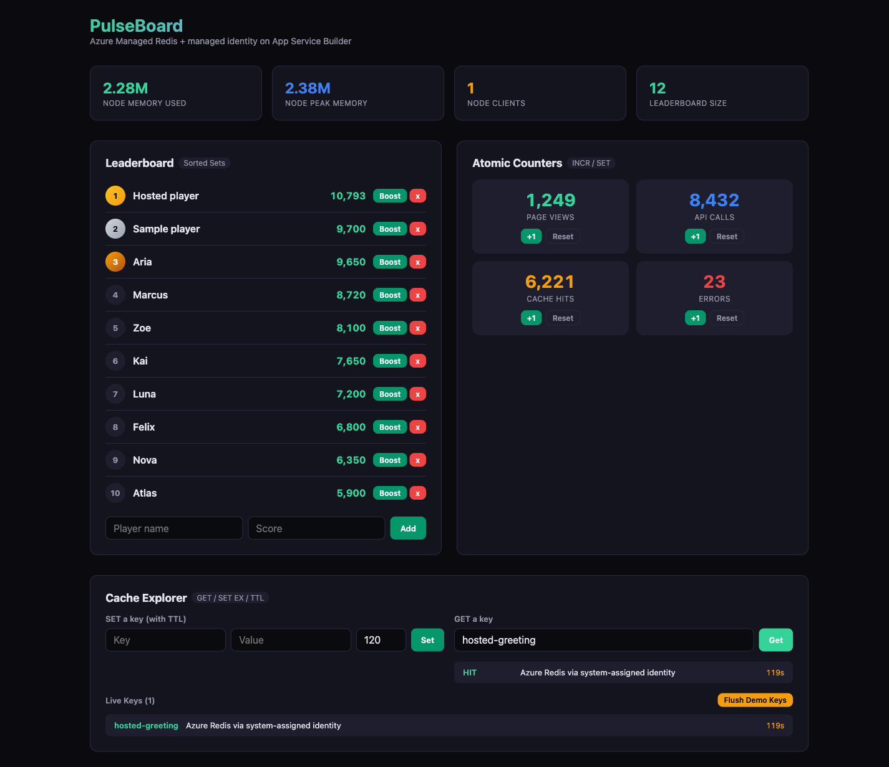
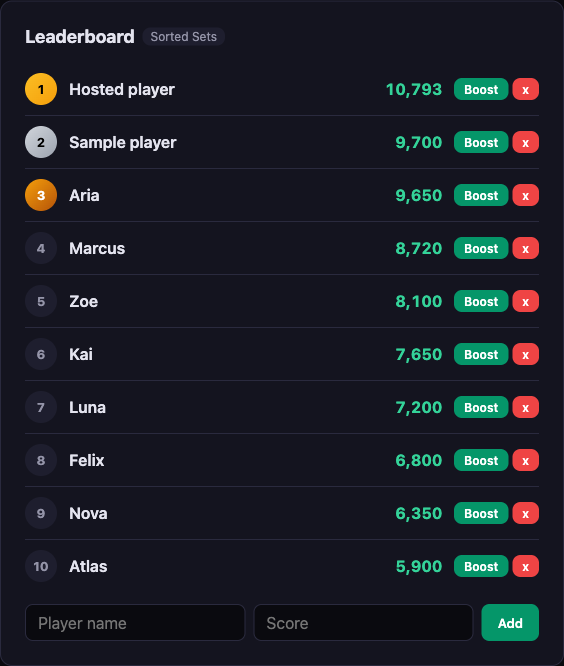
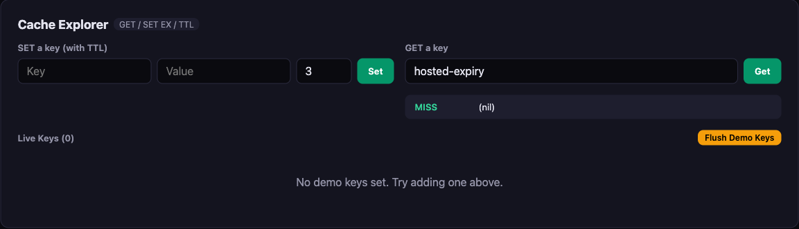

# PulseBoard: Azure Managed Redis on App Service Builder

PulseBoard preserves the original React/Express dashboard: atomic counters, a
sorted-set leaderboard and a cache explorer with hit/miss and TTL demonstrations.
The backend connects to **separately provisioned Azure Managed Redis** over TLS
using Microsoft Entra ID. There are no Redis passwords, embedded cache resources,
implicit localhost connections or simulated successful responses.

This is a **development/test** sample for
[App Service Builder](https://builder.appservice.azure.com/docs/), not ordinary
Azure App Service. Verify Node.js compute activation on your preview target.
Publication and hosted qualification are separate from a successful local build.

## Architecture and security

Two independently buildable components preserve the same origin: the Vite
frontend under `client/` is static at `/`, and the Node.js 24 API under `server/`
is mounted at `/api`. Separate package and lock files prevent Vite framework
detection from misclassifying the API as a static frontend. The root npm
workspace is for local development and regression tests.
Redis uses `OSSCluster`; `@redis/client` and `@redis/entraid` handle cluster
discovery, TLS, refreshed credentials and automatic `AUTH` on open connections.
The Redis packages use the maintained 5.12.1 release line: 6.x currently brings
an MSAL authorization-code-flow advisory. A scoped override updates MSAL 2's
`uuid` dependency to patched CommonJS-compatible 11.1.1; the `v4` API used by
MSAL is unchanged. No MSAL major-version override is applied. Recheck these
temporary dependency choices when upgrading. Vite 8 and its compatible React
plugin retain the existing UI.
Refresh starts at 80% of the credential lifetime. Reconnect uses bounded
exponential backoff; offline commands fail instead of waiting indefinitely.
Startup connects, checks Redis and initializes demonstration data before listening.
`/api/health` actually pings Redis and returns 503 if the dependency is unavailable.

**System-assigned managed identity is the hosted default.** A user-assigned
identity is optional. `REDIS_AUTH_MODE=developer` explicitly enables local
`DefaultAzureCredential`; it does not follow your workstation login into Azure.
No credentials are placed in a URL or browser assets.

All keys use `pulseboard:{<namespace>}:*`. The shared Redis hash tag keeps
transactions and multi-key commands on one cluster slot. This is intentional for
a tiny sample, not a high-throughput sharding design. The cache explorer maintains
a namespaced sorted-set registry rather than scanning the cluster. Flush deletes
only that registry's demonstration keys, never counters, leaderboard or another
application's data. The interactive list displays at most 50 entries; concurrent
writers can temporarily exceed that advisory limit.

`infra/access.bicep` grants individual required commands and only the sample key
pattern. It does not grant Azure management roles, `FLUSHALL`, `FLUSHDB`, `KEYS`,
`SCAN`, scripts, configuration or arbitrary key access. `INFO` is permitted for
the original dashboard; memory/client metrics describe the selected Redis node,
not tenant-isolated statistics or necessarily the whole cluster.
Custom ACL assignments use API `2026-05-01-preview` and require a cache without
Redis modules. This is a documented Redis preview feature.

**Network boundary:** this economical DEV/TEST deployment creates a new public
TLS endpoint with access-key authentication disabled. Builder currently does
not provide customer VNet integration or stable outbound IPs. Do not weaken an
existing resource's firewall to run the sample. If your policy requires private
connectivity or an IP allowlist, this preview target cannot satisfy that policy.
The sample UI deliberately permits data mutations: protect hosted access using
[Builder visitor sign-in](https://builder.appservice.azure.com/docs/guides/authentication/)
and restrict it to your testers; do not expose it as a production public API.

## Prerequisites

- Node.js 24 and npm for local development.
- Azure CLI and Bicep, an explicitly chosen subscription, an existing DEV/TEST
  resource group and permission to provision new Redis dependencies.
- An App Service Builder preview target that activates Node.js 24 compute
  (currently East US 2 or West US 2; verify your environment).
- Permission to create Redis data access assignments for your app identity and,
  separately, a developer principal if testing locally.
- For GitHub deployment, your own published repository/fork, a root
  `builder.yaml`, and Builder's GitHub integration authorized for that repository.

Read [current feature availability](https://builder.appservice.azure.com/docs/resources/feature-status/)
and [managed identity](https://builder.appservice.azure.com/docs/guides/managed-identity/)
before deployment. Older bundled plugin guidance may predate current identity
support. Installing a plugin does not provision Redis or grant permissions.

## 1. Provision the Redis dependency

Choose a unique **new** cache name. Keep subscription arguments explicit; do not
rely on your CLI default subscription.

```bash
export SUBSCRIPTION_ID="<your-devtest-subscription-id>"
export RESOURCE_GROUP="<your-existing-devtest-resource-group>"
export CACHE_NAME="<unique-new-managed-redis-name>"
export REDIS_LOCATION="eastus2"

az group show --subscription "$SUBSCRIPTION_ID" --name "$RESOURCE_GROUP"
az deployment group validate \
  --subscription "$SUBSCRIPTION_ID" --resource-group "$RESOURCE_GROUP" \
  --name pulseboard-redis-validate --template-file infra/main.bicep \
  --parameters cacheName="$CACHE_NAME" location="$REDIS_LOCATION"
az deployment group what-if \
  --subscription "$SUBSCRIPTION_ID" --resource-group "$RESOURCE_GROUP" \
  --name pulseboard-redis --template-file infra/main.bicep \
  --parameters cacheName="$CACHE_NAME" location="$REDIS_LOCATION"
```

Review the changes and costs, then provision:

```bash
az deployment group create \
  --subscription "$SUBSCRIPTION_ID" --resource-group "$RESOURCE_GROUP" \
  --name pulseboard-redis --template-file infra/main.bicep \
  --parameters cacheName="$CACHE_NAME" location="$REDIS_LOCATION"
az deployment group show \
  --subscription "$SUBSCRIPTION_ID" --resource-group "$RESOURCE_GROUP" \
  --name pulseboard-redis --query properties.outputs -o json
```

Use the returned `redisEndpoint` verbatim, including port 10000. The Bicep creates
Balanced B0, no high availability, no modules, no persistence, OSS clustering,
TLS 1.2 minimum, Entra-only authentication and `NoEviction`. This avoids silent
loss of counters/leaderboard when full; writes fail explicitly at the memory
limit. Do not use this availability/durability profile in production.
If B0 has no capacity, try another approved region with the **same** SKU; do not
silently choose a large production tier. Bicep may report missing type definitions
for newer API versions; ARM preflight validation remains necessary.

## 2. Assign the app identity and grant Redis access

Create a new Builder app in your approved location, with this source repository
and branch. Keep `builder.yaml` at the repository root. On **Identity**, enable
system-assigned identity and choose **Save and deploy**. For a first deployment
without a usable build, identity can be saved before source activation.
Copy the returned **principal ID** (object ID), not an application/client ID.

Use the Portal or the documented
[ARM identity contract](https://builder.appservice.azure.com/docs/reference/arm-api/#managed-identity-contract).
Identity assignment itself does not authorize Redis.

```bash
export APP_PRINCIPAL_ID="<builder-system-identity-principal-id>"
export REDIS_NAMESPACE="demo"
az deployment group create \
  --subscription "$SUBSCRIPTION_ID" --resource-group "$RESOURCE_GROUP" \
  --name pulseboard-app-access --template-file infra/access.bicep \
  --parameters cacheName="$CACHE_NAME" principalId="$APP_PRINCIPAL_ID" \
    assignmentName=pulseboard-app namespace="$REDIS_NAMESPACE"
```

Use 1-40 letters, digits, underscores or hyphens for the namespace, and use the
same value in the grant and app. Review the ACL before granting it. Each
principal can have only one Redis data assignment per instance; do not overwrite
an existing principal's unrelated assignment. Wait for assignment provisioning
to report success and allow time for propagation.

**User-assigned alternative:** provision your own user-assigned identity, attach
its resource ID on Builder's Identity page, grant that identity's principal ID
using the same access template, and set `AZURE_CLIENT_ID` to its **client ID**.
Do not set `AZURE_CLIENT_ID` for system-assigned identity.

## 3. Configure and deploy PulseBoard

Save only these non-secret variables on Builder's Variables page:

| Variable | Value |
| --- | --- |
| `REDIS_ENDPOINT` | Provisioning output, such as `name.eastus2.redis.azure.net:10000` |
| `REDIS_NAMESPACE` | `demo`, matching the data access grant |
| `REDIS_AUTH_MODE` | `managed-identity` (default) |
| `AZURE_CLIENT_ID` | Unset for system identity; selected user identity client ID otherwise |

Variables are captured by the next version build. Saving them does not change
an already running version. Builder sets the runtime port; the manifest declares
8080 and the API listens on `0.0.0.0`. Builder builds the independent Vite
component into static `dist` output. The API's `build:builder` uses its own
`npm ci` and stages the complete server and dependencies under
`$DESTINATION_DIR`; hosted startup is not a Vite development server.
The API install explicitly sets `--prefix . --workspaces=false`: Builder keeps
the app's parent source tree present, so an ordinary workspace-aware `npm ci`
would hoist dependencies outside the API output instead of staging them.

Deploy the intended pushed source using the
[Portal](https://builder.appservice.azure.com/docs/quickstarts/portal/) or the
installed [Builder CLI](https://builder.appservice.azure.com/docs/quickstarts/builder-cli/).
Check installed command help before using CLI options. Optional local validation:

```bash
builder manifest validate . --json
```

Wait for deployment completion, inspect the active version, open the returned
runtime URL and request `/api/health`. Then exercise the real operations below.
A valid manifest/build, successful resource creation or accepted deployment is
not hosted integration qualification.

## Local development with Entra credentials

Grant your **developer object ID** separately, using assignment name
`pulseboard-developer` and the same namespace:

```bash
az login --tenant "<your-tenant-id>"
az account show --subscription "$SUBSCRIPTION_ID" --query '{id:id,tenantId:tenantId}'
az ad signed-in-user show --query id -o tsv
# Use the returned object ID as DEVELOPER_PRINCIPAL_ID:
az deployment group create \
  --subscription "$SUBSCRIPTION_ID" --resource-group "$RESOURCE_GROUP" \
  --name pulseboard-developer-access --template-file infra/access.bicep \
  --parameters cacheName="$CACHE_NAME" principalId="$DEVELOPER_PRINCIPAL_ID" \
    assignmentName=pulseboard-developer namespace="$REDIS_NAMESPACE"

npm ci
npm test
npm run build
export REDIS_ENDPOINT="<redisEndpoint-output>"
export REDIS_AUTH_MODE=developer
export HOST=127.0.0.1
export PORT=3187
npm start
```

Azure directory commands operate against the signed-in tenant, not a subscription
resource. Do not print tokens. `DefaultAzureCredential` may choose another
configured developer credential before Azure CLI; ensure it is the principal
you granted. `.env.example` documents variable names; `.env` is ignored and is
not loaded implicitly. Alternatively, Node 24 supports `node --env-file=.env
server/index.js` after you prepare a local ignored file.

## Exercise the real operations

Open the app URL. Increment and reset a counter; add, boost and remove a player.
Set `greeting=Hello from Redis` with TTL 60, look it up for **HIT**, wait for
expiry and repeat for **MISS**. Confirm only demonstration keys disappear when
you flush; counters and leaderboard remain. Invalid values display an error
instead of resetting the form and claiming success.

For a terminal check, set `APP_URL` to your local or hosted origin. If visitor
sign-in is enabled, use your signed-in browser for hosted operations instead.

```bash
curl --fail "$APP_URL/api/health"
curl --fail "$APP_URL/api/counters"
curl --fail -X POST "$APP_URL/api/counters/page_views/increment"
curl --fail "$APP_URL/api/leaderboard"
curl --fail -H 'Content-Type: application/json' \
  -d '{"key":"greeting","value":"Hello from Redis","ttl":60}' "$APP_URL/api/cache-demo/set"
curl --fail "$APP_URL/api/cache-demo/get/greeting"
curl --fail "$APP_URL/api/cache-demo/keys"
```

`npm run test:redis` performs real cluster operations with your configured Entra
credential: namespace-denial, set/get/TTL expiry, counters, leaderboard and a
same-slot transaction. It also keeps connections active across an accelerated
refresh, checks the provider reacquires credentials and Redis receives `AUTH`,
then recreates a connection using renewed credentials. Only client expiration metadata
is shortened to 20 seconds; the real signed Entra token is unchanged. This is
**not** a full natural-token-expiry soak or hosted identity evidence. Run a
long-duration hosted exercise across real credential expiry separately before
claiming that qualification. Verification keys are removed on successful cleanup.

For an explicitly approved private renewal investigation,
`PULSEBOARD_RENEWAL_DIAGNOSTICS=1` enables server-side JSON observations; the
default is off. They contain only timestamps, random process/connection
identifiers, connection generations and authentication outcomes, never tokens,
claims, account IDs or Redis values. Successful `AUTH` is logged only after
the SDK command resolves. The observer retains credential objects, token expiry
and SDK scheduling unchanged. It relies on the pinned node-redis transport
method also observed by the verification script; revalidate it on upgrades.
Heartbeats are limited to one per minute and observations stop after 30 hours.
There is no diagnostic HTTP endpoint. Configure an approved private runtime-log
destination before enabling this setting, and treat restart/reconnect or missing
initial-expiry/acknowledgement records as inconclusive rather than renewal proof.
Logging instrumentation alone does not establish a passed natural-expiry soak.

## Screenshots and evidence boundary

On November 3, 2026, both components built on Node.js 24.22.1 and the hosted API
connected to Azure Managed Redis using its **system-assigned managed identity**.
Required Entra sign-in restricted access to one trusted tenant and one tester
object ID; unauthenticated `/` and `/api/health` requests returned 401.
The signed-in browser's tenant/object claims matched the allowed tester.

Real hosted checks passed: Redis health, persistent counter increments,
leaderboard add/boost/remove, SET/GET with a positive TTL, and a three-second
key changing from HIT to MISS with Redis TTL `-2`. Scoped flush removed only
cache-demo keys while counters and the leaderboard remained unchanged.
These are actual Microsoft Edge screenshots, not fixtures.







**Qualification limits:** this hosted DEV/TEST evidence used a temporary internal
source upload, not the GitHub-source integration taught above. GitHub-source
deployment and a full natural-token-expiry hosted renewal/soak remain unverified.
The real-Redis accelerated reauthentication/reconnection check described above
used developer credentials; it is not substituted for hosted renewal evidence.
Earlier local-with-Azure captures are retained separately:
[dashboard](docs/assets/pulseboard-dashboard-local-azure.png),
[leaderboard](docs/assets/pulseboard-leaderboard-local-azure.png), and
[TTL expiry](docs/assets/pulseboard-cache-expiry-local-azure.png).

## Troubleshooting

| Symptom | Check |
| --- | --- |
| Startup fails with missing endpoint | Set `REDIS_ENDPOINT=hostname:port`, not a URL, token or password. There is no localhost fallback. |
| Token acquisition fails | Identity is assigned to the running app version; system identity has no `AZURE_CLIENT_ID`; user identity client ID matches the attached identity. Local runs explicitly use `developer`. |
| `WRONGPASS`, `NOAUTH` or `NOPERM` | Grant the credential's object ID, not client ID; check assignment success/propagation and matching namespace. Azure Contributor alone is not Redis data access. |
| Cluster discovery/reconnect fails | TLS DNS name and all discovered Redis node ports must be reachable. The address map preserves endpoint DNS for advertised IPs and TLS verification stays enabled. |
| `CacheCapacityUnavailable` | B0 capacity varies by region. Revalidate the same economical SKU in another approved region; stop rather than auto-upgrading. |
| `OOM` / write failure | B0 is deliberately small and uses `NoEviction`; remove demo data or approve a larger tier. Do not fake success or silently evict durable-looking counters. |
| Build succeeds but activation fails | Check Node.js support on the selected Builder location. Do not keep deploying unsupported compute output or silently replace the runtime. |
| `/api/health` returns 503 | Inspect sanitized backend logs, identity assignment, Redis access policy and network reachability. A web page alone does not prove Redis works. |
| Settings were saved but behavior is unchanged | Build/deploy a new version; identity-only redeployment and variable changes have different version behavior. |

## Costs and cleanup

On November 3, 2026, the Azure retail meter
`Azure_Managed_Redis_Balanced_B0` in East US and East US 2 listed **USD $0.016/hour**
(about **$11.68 for 730 hours**). Verify the exact deployment region's current
meter before provisioning. Availability, taxes, networking, high availability
and Builder compute are separate; there is no free-tier guarantee or automatic
scale-to-zero for this Redis instance. Resources accrue charges until deleted.

Track the cache, default database, app, data assignments and any optional
user-assigned identity you create. Request reviewed cleanup when finished.
Delete only sample-owned resources, not an existing/shared resource group:

```bash
# Run only after reviewing and approving these exact deletions.
az redisenterprise delete --subscription "$SUBSCRIPTION_ID" \
  --resource-group "$RESOURCE_GROUP" --name "$CACHE_NAME"
```

Delete the sample Builder app separately in its Portal **Danger zone** and
confirm asynchronous cleanup. App deletion removes its system identity, not
a separately owned user identity. Removing the cache removes its database and
data assignments. Never delete a shared user identity or resource group to
make cleanup convenient.

## References

- [Maintained Node.js Redis quickstart](https://learn.microsoft.com/en-us/azure/redis/nodejs-get-started)
- [Entra Redis authentication](https://learn.microsoft.com/en-us/azure/redis/entra-for-authentication)
- [Custom Redis data permissions](https://learn.microsoft.com/en-us/azure/redis/configure-access-permissions)
- [Builder manifest](https://builder.appservice.azure.com/docs/guides/builder-yaml/)
- [Builder service connections](https://builder.appservice.azure.com/docs/guides/connect-to-services/)
